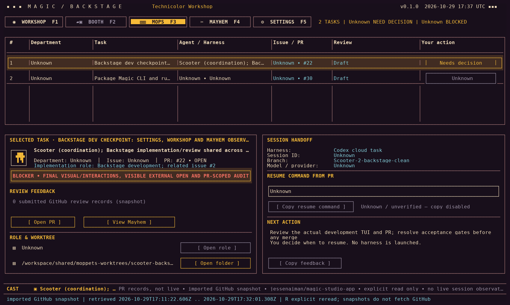
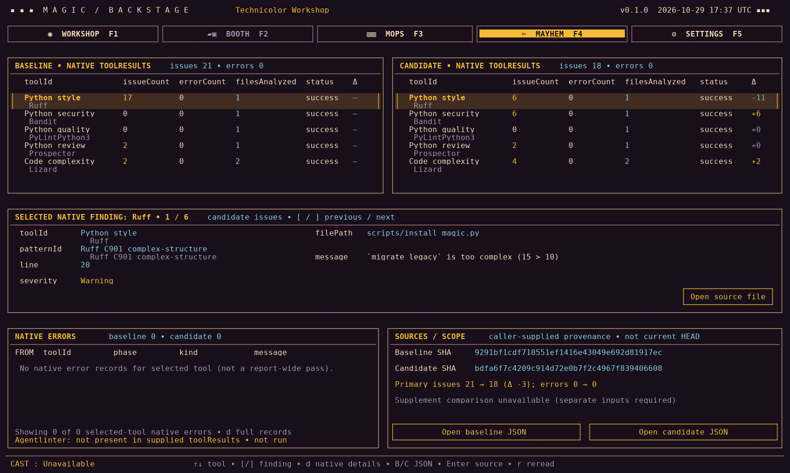

# Magic Studio

**Storyboard, animate, design lyrics, and compose a song video in one desktop
workspace.** Magic Studio is Jesse Naiman's creative production app, with a native
Tauri shell, a shared Rust engine, and the same operations available to its agent,
CLI, and MCP clients.

[Repository](https://github.com/jessenaiman/magic-studio-app) ·
[Documentation](docs/README.md) ·
[中文](README_zh-CN.md) · [Production guide](MAGIC-STUDIO.md) ·
[Source installation](agent-harness/cli_anything/magic/README.md)

## Frontstage — the creative workspace

| Area | Work here |
|---|---|
| **Storyboard** | Bring in the song and timed words, author the editable DeckCraft scene plan, and review artwork. |
| **Animation** | Prepare layered characters, place motion, and work with the Blender rendering workflow. |
| **Lyrics** | Design lettering, hero words, and motion graphics against the song's timing. |
| **Studio** | Compose and preview the linked HyperFrames video in the project. |

Sproket provides project conversation; Gaffer handles artwork. Projects retain
source media, timing, editable documents, and generated receipts together. File
menu New/Open/Save and application settings use the same guarded commands as the
CLI. Save project media in the selected production folder, outside this checkout.

### Start with the installed app

```sh
magic
magic-cli --help
magic-cli commands
```

Open a specific project with `magic /absolute/Song.magic`. To work through its
agent tools, explicitly select it with
`magic-cli studio open /absolute/Song.magic`, then discover the command family. The
[Magic skill](agent-harness/cli_anything/magic/skills/SKILL.md) documents project
selection, verified syntax, and MCP configuration. Opening the app does not
require a repository checkout or a Python production-stack setup.

For the song-to-video path, see the [production guide](MAGIC-STUDIO.md) and
[reference → animation → video](docs/workflows/reference-to-animation-video.md).
Storyboard preparation is a draft, not completed artwork or creative approval.
Review the actual scene content and the reported missing fields before proceeding.

## Backstage — the observer

Backstage is a separate Rust/Ratatui terminal workspace for production and
engineering visibility. **Workshop** shows saved project references, **MOPS**
shows PR-owned task handoffs, **Mayhem** shows worktree and native audit evidence,
and **Settings** shows observed production paths and crew documents.

### MOPS: task and session handoff



Actual native terminal capture from 29 October 2026, using imported GitHub PR
snapshots. Unknown fields stay unknown; Backstage does not launch or resume agents.

### Mayhem: inspect the evidence



Actual native audit-artifact view from the same review. These are historical
baseline/candidate results, not an audit of the current checkout. Live GitHub,
external-open, and clipboard acceptance remain separate from these captures.
See [Backstage usage and current limits](apps/backstage/README.md).

## Build and extend

Use the [single source-installation guide](agent-harness/cli_anything/magic/README.md)
for development builds and local installation. UI assets are embedded in the
native app and need a rebuild when changed. The CLI-Anything harness is an
application adapter, not a replacement native-app installer.

Reusable Python tools, pipeline YAML, stage directors, schemas, and skills remain
part of Magic Studio. [Project context](PROJECT_CONTEXT.md) maps the desktop and
production layers; [the agent guide](AGENT_GUIDE.md) explains when to use each.
Follow [contribution guidance](CONTRIBUTING.md) before changing the app.

Start with the [architecture reading guide](docs/architecture/README.md) to trace
the shell, shared command engine, and separate Backstage observer. Build the
[searchable Rust API reference](docs/RUSTDOC.md) locally with the standard Rust
toolchain; the documentation guide states exactly which crates are covered.

## License and credits

See [LICENSE](LICENSE), [source attribution](SOURCE-ATTRIBUTION.md), and component
notices for licensing, original authorship, and upstream credit.
