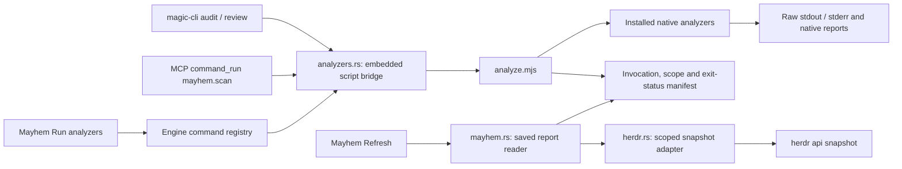

# Mayhem: native analyzer reports

One runner, `scripts/analyze.mjs`, calls the installed tools. CLI,
MCP and the desktop use that same implementation. There is no second engine
that remeasures source, invents findings, assigns grades or estimates coverage.
The existing Mayhem grid, charts, command tree, report details and Backstage
terminal remain. Charts display Lizard's native XML values, not pass rates.



## Run it

```sh
magic-cli audit --quick
magic-cli audit
magic-cli --json audit --tool tsc --tool lizard
magic-cli review apps/src-tauri/ui/analytics.ts
magic-cli mayhem evidence
```

Quick directory runs select TypeScript, ESLint and Stylelint. A specific Rust
file selects Clippy; a CSS file selects Stylelint; a TS/JS file selects
TypeScript and ESLint. Comprehensive runs select all nine configured tools:
Clippy, TypeScript, ESLint, Stylelint, Lizard, Wallace, jscpd, PurgeCSS and Git
scope. Explicit `--tool` selections replace the profile. Missing tools are
reported as execution failures; the runner never installs or substitutes one.
`--dry-run` describes commands without execution or saved results.

MCP uses the installed `magic-cli mcp` and its existing official SDK transport:

```json
{"name":"command_run","arguments":{"id":"mayhem.scan","params":{"quick":true}}}
{"name":"command_run","arguments":{"id":"mayhem.scan","params":{}}}
{"name":"command_run","arguments":{"id":"mayhem.evidence","params":{}}}
```

`mayhem.scan` also accepts `path`, `tools`, `base` and `dry_run`. `path` selects
the source file/directory to analyze; it does not select a creative project.
Clippy/TypeScript run against repository configuration, and PurgeCSS uses its
configured content paths. Wallace measures the primary UI stylesheet for a
directory run. The report records each scope and the complete argument list;
"comprehensive" means all configured tools, not proof of universal coverage.
`base` must resolve to one commit (branch, tag, SHA or commit expression).
The runner verifies it using `git rev-parse --verify --end-of-options` and
passes only the verified object ID to diff; option-shaped/invalid inputs fail
before analyzers run. See [Git's documented untrusted-name boundary](https://git-scm.com/docs/git-rev-parse#Documentation/git-rev-parse.txt---verify).

## Retained evidence

Each explicit run creates `target/analytics/analyzer-runs/<run-id>/` with:

- Complete byte-preserving `<tool>.stdout` and `<tool>.stderr` files for
  commands that executed. Launch failures retain metadata without invented output.
- `report.json` containing each tool's invocation, scope, exit code, signal or
  launch error, plus revision and working-tree status.
- Additional files emitted by native tools, including jscpd's JSON report.
  Its complete contents are also included in CLI/MCP manifests and shown in
  the UI, so a remote MCP client does not need separate filesystem access.

`target/analytics/analyzers.json` is replaced atomically with the latest
completed manifest. Previous run directories and legacy audit/history/review
files remain intact. An unavailable tool has a null native exit code and its
real launch error; it never becomes a zero. A dry run has no measurements.
CLI exits with the first failing command's status, or 2 for a launch failure.
MCP returns the report plus `runner_exit_code`; transport success does not mean
all analyzers passed. Native exit 0 is a command outcome, not an app grade.

The runner is longer than a terminal-call loop because it retains exact scope,
arguments, byte-complete artifacts, launch/signal failures, profiles and a
safe latest-report pointer. The runner uses Node standard process/file APIs and requires Node on PATH. The
58-line Rust bridge embeds the script, so installed binaries need no separate
script path. There is no additional analysis framework.
The tiny frontend Lizard XML adapter only presents native labels/values.
The existing explicit `doctor` auto-fix command stays separate from this runner.

## Herdr activity

This is a separate read-only adapter, not worktree inference. Its interface is
verified against [Herdr's CLI implementation](https://github.com/herdrdev/herdr/blob/ee5bfb5041bb3e4a49d591c72308aae3c81ecdde/src/cli/api.rs)
and [published snapshot schema](https://github.com/herdrdev/herdr/blob/ee5bfb5041bb3e4a49d591c72308aae3c81ecdde/src/api/schema/session.rs).
It uses `herdr api snapshot` from a Herdr caller context, never the focused
workspace as a substitute for the caller's workspace.

The adapter verifies the explicit `workspace_id` or `HERDR_WORKSPACE_ID`
against the snapshot and filters panes to that workspace and the canonical
project directory or descendants. The selected `.magic` project's directory
is used when bound; otherwise the current directory is the declared project
scope. Unknown directories are excluded and counted. Agent and tab joins use
real IDs, with names taken from snapshot fields. Missing names, kinds, status,
workspace context or unsupported schemas stay unknown. No issue-title matching,
branch-name guesses, other-worktree scans or unrelated usage-directory scans
run in this path. No settings are changed and no terminal control is issued.

## Backstage: one small report reader

Backstage now reads the same manifest in one Rust file. It has a tool list and
five text views: Output, Command, Run, Files and Activity. One action definition,
input map and dispatcher serve keyboard and mouse; rendering is read-only and
returns fresh action targets. It never runs analyzers. Activity explicitly calls
the existing native Herdr adapter, retaining bounded child cancellation and
unknown states. See [controls and removals](../apps/backstage/README.md).

Removed TUI orchestration: Workshop/project browsing, Settings/crew inspection,
MOPS PR imports and handoffs, clipboard/resume actions, Git inventory, baseline
comparisons, legacy audit adapters and external openers. These removals implement
the user's narrowed request for a simple existing-report reader. No saved project,
report, history or settings data is removed. Desktop Mayhem and the native runner
are unchanged by this structural reduction.

## Observed verification and size

No new tests. Review also verified that FIFO and malformed report inputs are
rejected promptly; Linux report opens are nonblocking before descriptor checks.
Header/status text is sanitized for display. Live 45×12, 80×19 and 100×24 terminal interaction covered keyboard/mouse tool and
view selection, all five views, vertical/horizontal scrolling, expand/close,
report rereading, native Activity response and Quit. Paging uses the actual
rendered content height (2/9/14 lines in those terminals); brackets and the
mouse wheel move one line, keeping every report line reachable. The real nine-tool report's
checksum was unchanged. Plain whole-report output matched its input; selected
tsc output retained native exit 0. Backstage build, scoped Clippy and whitespace
checks passed. Herdr reports unavailable caller context here; successful live
Herdr and desktop embedding remain unverified. Earlier real CLI/MCP analyzer
runs preserved Clippy 101 (missing GTK development files), tsc 0, ESLint 1,
Stylelint 2 and zero statuses for Lizard, Wallace, jscpd, PurgeCSS and Git scope.

Counts are physical lines, including blanks/comments, across the same union of
all Rust files under `apps/backstage/src`. Deleted files count zero; the temporary
unpublished multi-screen refactor is not used as a baseline. Dependencies,
generated files and documentation are excluded on both sides.

| Scope | Before | After |
| --- | ---: | ---: |
| Whole Backstage, baseline `9b36324` | 8,355 | 747 |
| Whole Backstage, previous published `7f5d8ee` | 4,279 | 747 |
| Source files, previous published | 14 | 1 |

The 747 lines include the native Activity process lifecycle and limits, not just
rendering. The unchanged analyzer script is 73 lines and its Rust bridge 58;
Herdr adapter 78, engine report reader 61, desktop Mayhem 138 (408 combined).
Existing shared ECharts renderer (60), Mayhem CSS (69), MCP transport (178), CLI,
registry and component files are retained; their unrelated code is not called
audit-only code or counted as Backstage. For the earlier explicit broader union,
including those whole shared files, source shrank from 16,102 to 6,113 lines.
