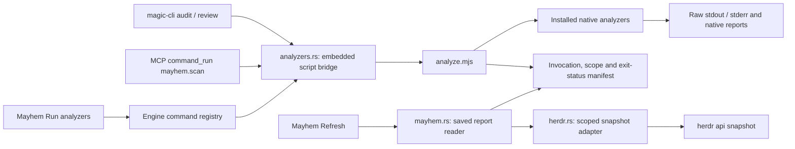

# Mayhem: native analyzer reports

One runner, `scripts/analyze.mjs`, calls the installed tools. CLI,
MCP and the desktop use that same implementation. There is no second engine
that remeasures source, invents findings, assigns grades or estimates coverage.
The existing Mayhem grid, charts, command tree, report details and Backstage
terminal remain. Charts display Lizard's native XML values, not pass rates.



## Run it

```sh
magic-cli audit --quick
magic-cli audit
magic-cli --json audit --tool tsc --tool lizard
magic-cli review apps/src-tauri/ui/analytics.ts
magic-cli mayhem evidence
```

Quick directory runs select TypeScript, ESLint and Stylelint. A specific Rust
file selects Clippy; a CSS file selects Stylelint; a TS/JS file selects
TypeScript and ESLint. Comprehensive runs select all nine configured tools:
Clippy, TypeScript, ESLint, Stylelint, Lizard, Wallace, jscpd, PurgeCSS and Git
scope. Explicit `--tool` selections replace the profile. Missing tools are
reported as execution failures; the runner never installs or substitutes one.
`--dry-run` describes commands without execution or saved results.

MCP uses the installed `magic-cli mcp` and its existing official SDK transport:

```json
{"name":"command_run","arguments":{"id":"mayhem.scan","params":{"quick":true}}}
{"name":"command_run","arguments":{"id":"mayhem.scan","params":{}}}
{"name":"command_run","arguments":{"id":"mayhem.evidence","params":{}}}
```

`mayhem.scan` also accepts `path`, `tools`, `base` and `dry_run`. `path` selects
the source file/directory to analyze; it does not select a creative project.
Clippy/TypeScript run against repository configuration, and PurgeCSS uses its
configured content paths. Wallace measures the primary UI stylesheet for a
directory run. The report records each scope and the complete argument list;
"comprehensive" means all configured tools, not proof of universal coverage.
`base` must resolve to one commit (branch, tag, SHA or commit expression).
The runner verifies it using `git rev-parse --verify --end-of-options` and
passes only the verified object ID to diff; option-shaped/invalid inputs fail
before analyzers run. See [Git's documented untrusted-name boundary](https://git-scm.com/docs/git-rev-parse#Documentation/git-rev-parse.txt---verify).

## Retained evidence

Each explicit run creates `target/analytics/analyzer-runs/<run-id>/` with:

- Complete byte-preserving `<tool>.stdout` and `<tool>.stderr` files for
  commands that executed. Launch failures retain metadata without invented output.
- `report.json` containing each tool's invocation, scope, exit code, signal or
  launch error, plus revision and working-tree status.
- Additional files emitted by native tools, including jscpd's JSON report.
  Its complete contents are also included in CLI/MCP manifests and shown in
  the UI, so a remote MCP client does not need separate filesystem access.

`target/analytics/analyzers.json` is replaced atomically with the latest
completed manifest. Previous run directories and legacy audit/history/review
files remain intact. An unavailable tool has a null native exit code and its
real launch error; it never becomes a zero. A dry run has no measurements.
CLI exits with the first failing command's status, or 2 for a launch failure.
MCP returns the report plus `runner_exit_code`; transport success does not mean
all analyzers passed. Native exit 0 is a command outcome, not an app grade.

The runner is longer than a terminal-call loop because it retains exact scope,
arguments, byte-complete artifacts, launch/signal failures, profiles and a
safe latest-report pointer. The runner uses Node standard process/file APIs and requires Node on PATH. The
58-line Rust bridge embeds the script, so installed binaries need no separate
script path. There is no additional analysis framework.
The tiny frontend Lizard XML adapter only presents native labels/values.
The existing explicit `doctor` auto-fix command stays separate from this runner.

## Herdr activity

This is a separate read-only adapter, not worktree inference. Its interface is
verified against [Herdr's CLI implementation](https://github.com/herdrdev/herdr/blob/ee5bfb5041bb3e4a49d591c72308aae3c81ecdde/src/cli/api.rs)
and [published snapshot schema](https://github.com/herdrdev/herdr/blob/ee5bfb5041bb3e4a49d591c72308aae3c81ecdde/src/api/schema/session.rs).
It uses `herdr api snapshot` from a Herdr caller context, never the focused
workspace as a substitute for the caller's workspace.

The adapter verifies the explicit `workspace_id` or `HERDR_WORKSPACE_ID`
against the snapshot and filters panes to that workspace and the canonical
project directory or descendants. The selected `.magic` project's directory
is used when bound; otherwise the current directory is the declared project
scope. Unknown directories are excluded and counted. Agent and tab joins use
real IDs, with names taken from snapshot fields. Missing names, kinds, status,
workspace context or unsupported schemas stay unknown. No issue-title matching,
branch-name guesses, other-worktree scans or unrelated usage-directory scans
run in this path. No settings are changed and no terminal control is issued.

## Observed verification

These are live command observations, not new regression tests. Commands ran
against the working patch based on `9b363245a1727b8dbc2fb7ce3a89765b5f49b0b9`;
reports retain the dirty working-tree state rather than claiming that base
revision alone contains the changes.

- `cargo build -p magic-cli -p backstage --locked`: passed.
- `cargo clippy -p magicstudio-engine -p magic-cli -p backstage --lib --bins --locked -- -D warnings`: passed.
- `npx tsc -p .`, `git diff --check`, and Bun's browser transpilation of
  `apps/src-tauri/ui/analytics.ts`: passed.
- CLI quick/comprehensive commands executed real native tools, preserving failures.
- MCP initialized, discovered `command_list`/`command_run`/`studio_open`, then
  executed selected and comprehensive scans and read the resulting evidence.
- A selected MCP TypeScript/Wallace run returned 0 for both commands after
  correcting Wallace's relative-path adapter. A default-PATH Lizard invocation
  recorded the actual missing-executable error with a null exit code.

The comprehensive MCP outcomes were Clippy 101, TypeScript 0, ESLint 1,
Stylelint 2, Lizard 0, Wallace 0, jscpd 0, PurgeCSS 0 and Git scope 0. Workspace
Clippy cannot build the desktop dependencies here because `glib-2.0.pc` is
missing; the engine/CLI-specific Clippy invocation above passes. ESLint and
Stylelint report existing style violations; their rules were not weakened.
Lizard 1.17.31 was installed only under the cloud workspace for observation,
with its PATH/PYTHONPATH supplied to those commands. No system installation or
settings changes were made.

Live Herdr remains unavailable: no `herdr` executable, `HERDR_ENV` or workspace
ID is present. Evidence reports `Herdr caller context unavailable
(HERDR_ENV != 1); no session queried`. Native desktop observation is also
unavailable: no desktop session/runtime directory is present and the user's
PC is disconnected. Type-checking is not a visual UI check. No PC worktree
cleanup, readiness change or merge is claimed.

Backstage was also exercised in an actual 80×24 terminal: imported PR #76,
selection, full-detail scrolling and native report loading worked; q exited
cleanly. Settings successfully observed project.root; crew.list reported the actual
missing department role file, and activity receipt writing hit the cloud
read-only home filesystem. Those remain visible failures, not passed flows.
The imported PR came from the authenticated GitHub connector, converted
to the documented native input fields; direct unauthenticated REST returned 403.
This verifies file import, not Backstage's live `gh` authentication. Clipboard success and a successful live Herdr snapshot remain unverified.
A follow-up 80×24 interaction traced actual mouse Open invocations: MOPS used
the selected PR URL; Settings used its selected settings.json, matching Enter.
The latter used temporary process-scoped XDG configuration created through
project.root; no existing user settings were changed. The native opener exited
3 in this environment, so successful application opening is not claimed.
A further native terminal pass used a CLI-created project and CLI-imported image
in a separate cloud directory with private process-scoped configuration. It
verified mouse/keyboard Mayhem entry, visible selection after group collapse,
empty-file Open disabled, and project-pane Enter targeting the .magic file.
Actual opener completion redrew without further input. No user project or
existing settings were changed. A follow-up trace confirmed two actual opener
processes overlapped. Completion events now carry request IDs, and only the
latest request updates the status; reverse completion order was not forced.

## Implementation size

The baseline is `9b363245a1727b8dbc2fb7ce3a89765b5f49b0b9`. Physical lines include
comments, blanks and existing tests. Missing files count zero. The same file
union is used before/after; documentation, generated output, dependencies and
reports are excluded on both sides. No new tests were added or run.

Whole Backstage means every Rust source under `apps/backstage/src`, including
unchanged handoff code and the new shared widgets: **8,355 → 4,279** lines
(48.8% removed). It is not a fourfold reduction. Removed presentation modules
are replaced by shared widgets and small views; provider/handoff functionality
remains. Its 4,279 lines comprise:

- Main lifecycle/input: 1,202; real project/settings observations: 883;
  bounded process provider: 330; unchanged PR handoff/parser/input: 826.
- Four views and navigation: 722; shared widgets: 125; native report reader: 191.

The dedicated runner, Rust bridge, Herdr adapter, engine report reader and desktop
Mayhem view total **408** lines (73 + 58 + 78 + 61 + 138). Backstage's report
reader/view add 398, including its inventory presentation. These totals do not
hide shared wiring: the complete scoped file union below includes entire CLI,
registry, component and Backstage files, even their unrelated retained code.
Thus its 9,645 lines are not 9,645 lines of audit logic. The unchanged ECharts
renderer (60), Mayhem stylesheet (69), and MCP transport (178) are shared
existing code outside this changed-file union, retained on both sides.

| File | Before | After |
| --- | ---: | ---: |
| `apps/magic-cli/src/audit.rs` | 931 | 0 |
| `apps/magic-cli/src/main.rs` | 526 | 561 |
| `crates/engine/src/analyzers.rs` | 0 | 58 |
| `crates/engine/src/complexity.rs` | 797 | 0 |
| `crates/engine/src/doctor.rs` | 663 | 91 |
| `crates/engine/src/herdr.rs` | 0 | 78 |
| `crates/engine/src/mayhem.rs` | 241 | 61 |
| `crates/engine/src/lib.rs` | 335 | 336 |
| `crates/engine/src/command_catalog.rs` | 1,407 | 1,379 |
| `crates/engine/src/commands.rs` | 179 | 151 |
| `apps/magic-cli/src/session.rs` | 386 | 397 |
| `apps/src-tauri/ui/analytics.ts` | 231 | 138 |
| `apps/src-tauri/frontend/analytics.test.ts` | 38 | 0 |
| `apps/magic-cli/src/doctor.rs` | 0 | 40 |
| `apps/src-tauri/ui/components.json` | 2,013 | 2,003 |
| `scripts/analyze.mjs` | 0 | 73 |
| `apps/backstage/src/audit.rs` | 685 | 191 |
| `apps/backstage/src/data.rs` | 401 | 381 |
| `apps/backstage/src/handoff.rs` | 237 | 237 |
| `apps/backstage/src/handoff/imports.rs` | 149 | 149 |
| `apps/backstage/src/handoff/input.rs` | 113 | 113 |
| `apps/backstage/src/handoff/pr.rs` | 327 | 327 |
| `apps/backstage/src/main.rs` | 1,150 | 1,202 |
| `apps/backstage/src/mayhem.rs` | 1,845 | 207 |
| `apps/backstage/src/mops.rs` | 50 | 110 |
| `apps/backstage/src/mops/cast.rs` | 100 | 0 |
| `apps/backstage/src/mops/selected.rs` | 263 | 0 |
| `apps/backstage/src/mops/session.rs` | 162 | 0 |
| `apps/backstage/src/mops/table.rs` | 171 | 0 |
| `apps/backstage/src/mops/widgets.rs` | 172 | 0 |
| `apps/backstage/src/project_data.rs` | 497 | 502 |
| `apps/backstage/src/provider.rs` | 327 | 330 |
| `apps/backstage/src/ui.rs` | 989 | 284 |
| `apps/backstage/src/workshop.rs` | 717 | 121 |
| `apps/backstage/src/widgets.rs` | 0 | 125 |
| **Full file union** | **16,102** | **9,645** |
